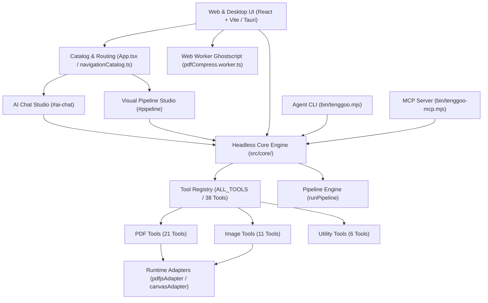

# Arsitektur & Panduan Pengembang

**Work Tool Super App** dirancang dengan arsitektur *Single Headless Core Engine* (`src/core/`): seluruh logika pemrosesan PDF, gambar, dan utilitas berjalan di atas abstraksi file memori (`VirtualFile`), sehingga logika yang sama dipakai ulang tanpa duplikasi oleh antarmuka Web, aplikasi Desktop (Tauri), AI Chat Studio, CLI (`bin/tenggoo.mjs`), dan MCP Server (`bin/tenggoo-mcp.mjs`).

---

## 1. Diagram Arsitektur Tingkat Tinggi



---

## 2. Peta Direktori & Modul

```text
tenggoo_pdf/
├── bin/
│   ├── tenggoo.mjs                  # Wrapper CLI Node.js (--experimental-strip-types)
│   └── tenggoo-mcp.mjs              # Wrapper MCP Server stdio JSON-RPC 2.0
├── docs/
│   ├── AI_AGENT_INTEGRATION.md      # Panduan AI Chat, OpenCode, Antigravity, MCP & CLI
│   └── ARCHITECTURE.md              # Dokumentasi arsitektur & panduan pengembang
├── skills/tenggoo-toolkit/
│   └── SKILL.md                     # Daftar lengkap 38 tool & skema untuk AI Agent
├── src/
│   ├── agent/
│   │   ├── cli.ts                   # Parser CLI (list, describe, run, pipeline)
│   │   ├── fileIO.ts                # Pembaca/penulis file disk <-> VirtualFile
│   │   ├── mcp-server.ts            # Implementasi JSON-RPC 2.0 (39 MCP tools)
│   │   └── toolkit.test.ts          # Test suite terpadu (unit, CLI & MCP)
│   ├── App.tsx                      # App shell, header ringkas, hash routing, sidebar kontekstual
│   ├── components/
│   │   ├── AllToolsHub.tsx          # Halaman awal katalog minimalis (pill kategori & pencarian)
│   │   ├── AIChatStudio.tsx         # Chat AI (#ai-chat): OpenCode, Antigravity, Local LLM, Offline
│   │   ├── PipelineStudio.tsx       # Builder visual multi-langkah & eksport/import preset
│   │   ├── CommandPalette.tsx       # Pencarian cepat global (Ctrl+K)
│   │   ├── navigationCatalog.ts     # Katalog navigasi UI (39 entri: 5 domain)
│   │   ├── ImageToolsStudio.tsx     # Studio alat gambar
│   │   ├── UtilityToolsStudio.tsx   # Studio utilitas (QR, Markdown, Table, ZIP, Hash)
│   │   ├── NewPDFToolsStudio.tsx    # Studio 10 alat PDF lanjutan (Redaksi, Form, Diff, N-up, dll.)
│   │   └── *.tsx                    # Komponen PDF klasik (MergePDF, SplitPDF, CompressPDF, dll.)
│   ├── core/
│   │   ├── index.ts                 # Barrel export TypeScript SDK
│   │   ├── types.ts                 # Tipe inti (VirtualFile, ToolDefinition, PipelineStep)
│   │   ├── registry.ts              # ALL_TOOLS, getTool(), listTools()
│   │   ├── pipeline.ts              # runPipeline() & smart wiring antar-langkah
│   │   ├── runtime/
│   │   │   ├── canvasAdapter.ts     # Abstraksi canvas lintas browser & Node.js
│   │   │   └── pdfjsAdapter.ts      # Integrasi pdfjs-dist lintas browser & Node.js
│   │   └── tools/
│   │       ├── pdfTools.ts          # 21 headless tools PDF
│   │       ├── imageTools.ts        # 11 headless tools Gambar
│   │       └── utilityTools.ts      # 6 headless tools Utilitas
│   ├── utils/
│   │   ├── pdfjs.ts                 # Konfigurasi worker pdfjs-dist untuk browser
│   │   └── virtualFileWeb.ts        # Konversi File API browser <-> VirtualFile & download ZIP
│   └── workers/
│       └── pdfCompress.worker.ts    # Kompresi Ghostscript WASM di Web Worker
└── src-tauri/                       # Konfigurasi & build aplikasi desktop native (Tauri v2)
```

---

## 3. Konsep Desain Utama

### A. Abstraksi `VirtualFile` Lintas Lingkungan
Seluruh tool di `src/core/tools/` menerima array `VirtualFile[]` (`{ name, mimeType, bytes: Uint8Array, metadata? }`) dan mengembalikan `ToolExecutionResult` (`{ files, summary, metadata? }`).
- **Di Browser / Tauri**: [src/utils/virtualFileWeb.ts](../src/utils/virtualFileWeb.ts) mengubah `File` hasil drag-and-drop menjadi `VirtualFile` di memori dan memicu unduhan Blob/ZIP tanpa menyentuh server eksternal.
- **Di CLI & MCP (Node.js)**: [src/agent/fileIO.ts](../src/agent/fileIO.ts) membaca file dari path disk menjadi `VirtualFile` dan menulis hasil kembali ke disk hanya bila diperlukan.

### B. Satu `ToolDefinition` & Skema JSON untuk Semua Kanal
Setiap tool mendefinisikan `id`, `mcpName`, `category`, `minInputs`/`maxInputs`, `parameterSchema`, serta fungsi `execute()` di [src/core/types.ts](../src/core/types.ts). Skema yang sama digunakan otomatis oleh:
1. Form dinamis di [PipelineStudio.tsx](../src/components/PipelineStudio.tsx).
2. Definisi *function calling* di [AIChatStudio.tsx](../src/components/AIChatStudio.tsx).
3. Perintah `list --json` dan `describe` di [cli.ts](../src/agent/cli.ts).
4. Handler `tools/list` di [mcp-server.ts](../src/agent/mcp-server.ts).

### C. Navigasi Hash & Tata Letak UI Minimalis
[src/App.tsx](../src/App.tsx) mengelola tampilan berdasarkan URL hash (`#semua-fitur`, `#ai-chat`, `#pipeline`, `#privacy-policy`, `#faq`, serta hash masing-masing tool dari [navigationCatalog.ts](../src/components/navigationCatalog.ts)):
- **Beranda (`#semua-fitur`)**: Sidebar desktop otomatis disembunyikan agar layar utama terasa lega dan tidak menduplikasi grid [AllToolsHub.tsx](../src/components/AllToolsHub.tsx). Header atas dibuat ringkas (Logo, `Ctrl+K`, **AI Chat**, dan GitHub).
- **Tampilan Tool (`#merge-pdf`, `#ai-chat`, dll.)**: Sidebar desktop muncul kembali untuk berpindah antar-tool dengan cepat tanpa kembali ke beranda, dilengkapi breadcrumb di atas area kerja dan footer untuk akses *Privacy & Policy* serta *FAQ*.

---

## 4. Alur Pengembangan, Pengujian, & Build

### Prasyarat
- **Node.js 22+** (dibutuhkan untuk flag `--experimental-strip-types` pada skrip tes, CLI, dan MCP server).
- **Rust / Toolchain Tauri** (hanya jika menjalankan build desktop `desktop:dev` / `desktop:build`).

### Perintah Pengembangan
```bash
# Install dependensi
npm install

# Jalankan server dev web (Vite)
npm run dev

# Jalankan seluruh automated tests (unit test 38 tool, pipeline, CLI, & MCP)
npm test

# Linting & Build produksi (TypeScript + Vite)
npm run lint
npm run build

# Mode Desktop Native (Tauri)
npm run desktop:dev
npm run desktop:build
```

*(Catatan di Windows: apabila PowerShell memblokir skrip `npm.ps1`, awali dengan `cmd /c`, misalnya `cmd /c "npm run dev"`).*

### Cara Menambahkan Tool Baru
1. Implementasikan `ToolDefinition` pada berkas kategori yang sesuai di `src/core/tools/` (`pdfTools.ts`, `imageTools.ts`, atau `utilityTools.ts`).
2. Pastikan tool masuk ke `ALL_TOOLS` di [src/core/registry.ts](../src/core/registry.ts) agar otomatis terbit di CLI, MCP Server, Pipeline Studio, dan AI Chat Studio.
3. Daftarkan entri navigasi dan rute hash UI-nya di [src/components/navigationCatalog.ts](../src/components/navigationCatalog.ts), lalu sambungkan tampilan komponennya di [src/App.tsx](../src/App.tsx) (atau mode studio terkait).
4. Tambahkan kasus uji di [src/agent/toolkit.test.ts](../src/agent/toolkit.test.ts) dan pastikan `npm test`, `npm run lint`, dan `npm run build` lolos.
