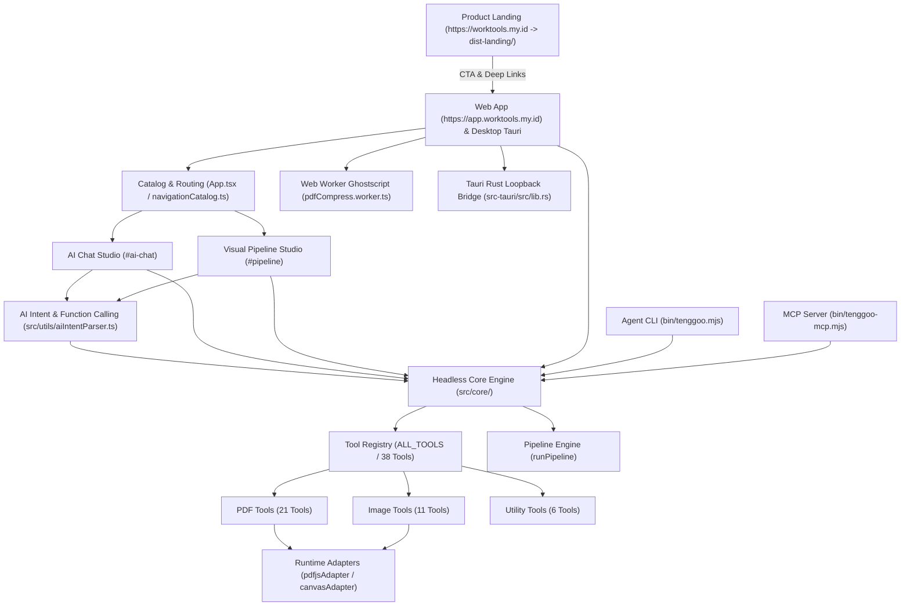

# Arsitektur & Panduan Pengembang

**WorkTools (Work Tool Super App)** dirancang dengan arsitektur *Single Headless Core Engine* (`src/core/`): seluruh logika pemrosesan PDF, gambar, dan utilitas berjalan di atas abstraksi file memori (`VirtualFile`), sehingga logika yang sama dipakai ulang tanpa duplikasi oleh **Web App** (`https://app.worktools.my.id`), **Landing Page** (`https://worktools.my.id`), **Aplikasi Desktop Windows** (Tauri v2), **AI Chat Studio**, **Visual Pipeline Studio**, **CLI (`bin/tenggoo.mjs`)**, dan **MCP Server (`bin/tenggoo-mcp.mjs`)**.

---

## 1. Diagram Arsitektur Tingkat Tinggi



---

## 2. Peta Direktori & Modul

```text
tenggoo_pdf/
├── landing/                         # Product Landing Page terpisah (https://worktools.my.id)
│   ├── index.html                   # SEO & OpenGraph Landing Page
│   ├── index.css                    # Tailwind styles & Apple utilities
│   ├── main.tsx                     # Entrypoint React Landing
│   ├── LandingApp.tsx               # Showcase tabs, bento privasi/fitur, Web vs Desktop, GitHub release fetch
│   └── public/                      # _headers (CSP), icons, robots.txt, sitemap.xml
├── bin/
│   ├── tenggoo.mjs                  # Wrapper CLI Node.js (--experimental-strip-types)
│   └── tenggoo-mcp.mjs              # Wrapper MCP Server stdio JSON-RPC 2.0
├── docs/
│   ├── AI_AGENT_INTEGRATION.md      # Panduan AI Chat, Pipeline Studio, OpenCode, Antigravity, MCP & CLI
│   └── ARCHITECTURE.md              # Dokumentasi arsitektur & panduan pengembang
├── skills/tenggoo-toolkit/
│   └── SKILL.md                     # Daftar lengkap 38 tool & skema untuk AI Agent
├── src/
│   ├── agent/
│   │   ├── cli.ts                   # Parser CLI (list, describe, run, pipeline)
│   │   ├── fileIO.ts                # Pembaca/penulis file disk <-> VirtualFile
│   │   ├── mcp-server.ts            # Implementasi JSON-RPC 2.0 (39 MCP tools)
│   │   └── toolkit.test.ts          # Test suite terpadu (unit, CLI, MCP, AI parser & security)
│   ├── App.tsx                      # App shell, header ringkas, hash routing, transfer file+steps ke Pipeline
│   ├── components/
│   │   ├── AllToolsHub.tsx          # Halaman awal katalog minimalis (pill kategori & pencarian)
│   │   ├── AIChatStudio.tsx         # Chat AI (#ai-chat): 38+1 tools, stepResults, preview teks, Pipeline handoff
│   │   ├── PipelineStudio.tsx       # Builder visual (#pipeline): AI Builder, 6 preset, kontrol blok & preview multi-file
│   │   ├── GuideSection.tsx         # Panduan interaktif dalam aplikasi (#panduan, #panduan-ai, #panduan-mcp)
│   │   ├── CommandPalette.tsx       # Pencarian cepat global (Ctrl+K)
│   │   ├── navigationCatalog.ts     # Katalog navigasi UI (39 entri: 5 domain)
│   │   ├── ImageToolsStudio.tsx     # Studio alat gambar
│   │   ├── UtilityToolsStudio.tsx   # Studio utilitas (QR, Markdown, Table, ZIP, Hash)
│   │   ├── NewPDFToolsStudio.tsx    # Studio 10 alat PDF lanjutan (Redaksi, Form, Diff, N-up, dll.)
│   │   └── *.tsx                    # Komponen PDF klasik (MergePDF, SplitPDF, CompressPDF, dll.)
│   ├── core/
│   │   ├── index.ts                 # Barrel export TypeScript SDK
│   │   ├── types.ts                 # Tipe inti (VirtualFile, ToolDefinition, PipelineStep)
│   │   ├── registry.ts              # ALL_TOOLS, getTool(), listTools()
│   │   ├── pipeline.ts              # runPipeline() & smart wiring antar-langkah
│   │   ├── runtime/
│   │   │   ├── canvasAdapter.ts     # Abstraksi canvas lintas browser & Node.js
│   │   │   └── pdfjsAdapter.ts      # Integrasi pdfjs-dist lintas browser & Node.js
│   │   └── tools/
│   │       ├── pdfTools.ts          # 21 headless tools PDF
│   │       ├── imageTools.ts        # 11 headless tools Gambar
│   │       └── utilityTools.ts      # 6 headless tools Utilitas
│   ├── utils/
│   │   ├── aiIntentParser.ts        # Offline intent parser, LLM tool schemas (38+1), & validasi step I/O
│   │   ├── pdfjs.ts                 # Konfigurasi worker pdfjs-dist untuk browser
│   │   └── virtualFileWeb.ts        # Konversi File API browser <-> VirtualFile & download ZIP
│   └── workers/
│       └── pdfCompress.worker.ts    # Kompresi Ghostscript WASM di Web Worker
├── src-tauri/                       # Aplikasi Desktop native Tauri v2 + Rust loopback HTTP bridge
├── vite.config.ts                   # Build Web App -> dist/
├── vite.landing.config.ts           # Build Landing Page -> dist-landing/
├── wrangler.jsonc                   # Worker `worktools-app` -> app.worktools.my.id
└── wrangler.landing.jsonc           # Worker `worktools` -> worktools.my.id
```

---

## 3. Konsep Desain Utama

### A. Abstraksi `VirtualFile` Lintas Lingkungan
Seluruh tool di `src/core/tools/` menerima array `VirtualFile[]` (`{ name, mimeType, bytes: Uint8Array, metadata? }`) dan mengembalikan `ToolExecutionResult` (`{ files, summary, metadata? }`).
- **Di Browser / Tauri:** [src/utils/virtualFileWeb.ts](../src/utils/virtualFileWeb.ts) mengubah `File` hasil *drag-and-drop* menjadi `VirtualFile` di memori dan memicu unduhan Blob/ZIP secara lokal.
- **Di CLI & MCP (Node.js):** [src/agent/fileIO.ts](../src/agent/fileIO.ts) membaca file dari path disk menjadi `VirtualFile` dan menulis hasil kembali ke disk hanya bila diperlukan (dilengkapi pembatas sandbox `TENGGOO_WORKSPACE_ROOT`).

### B. Satu `ToolDefinition` & Mesin AI Bersama (`src/utils/aiIntentParser.ts`)
Setiap tool mendefinisikan `id`, `mcpName`, `category`, `minInputs`/`maxInputs`, `parameterSchema`, serta fungsi `execute()` di [src/core/types.ts](../src/core/types.ts). Skema tunggal tersebut dipakai otomatis oleh:
1. Form dinamis, *AI Pipeline Builder*, serta pengecekan kecocokan MIME langkah berurutan (`checkPipelineStepCompatibility`) di [PipelineStudio.tsx](../src/components/PipelineStudio.tsx).
2. Definisi seluruh **38 tool** + **`tenggoo_pipeline_run`** untuk LLM *function calling* (`buildAiFunctionTools`, `parseAiToolCalls`) dan parser bahasa alami offline (`resolveIntentFromPrompt`) di [src/utils/aiIntentParser.ts](../src/utils/aiIntentParser.ts) yang dipakai bersama oleh [AIChatStudio.tsx](../src/components/AIChatStudio.tsx) dan [PipelineStudio.tsx](../src/components/PipelineStudio.tsx).
3. Perintah `list --json` dan `describe` di [cli.ts](../src/agent/cli.ts) serta `tools/list` di [mcp-server.ts](../src/agent/mcp-server.ts).

### C. Dua Build Terpisah untuk Kecepatan Maksimal & Tauri Kompatibel
- **Landing Page (`dist-landing/`):** Dibangun oleh [vite.landing.config.ts](../vite.landing.config.ts) tanpa membundel `gs.wasm` (±16 MB) atau worker PDF, sehingga halaman utama di `https://worktools.my.id` dimuat super cepat.
- **Web App & Desktop (`dist/`):** Dibangun oleh [vite.config.ts](../vite.config.ts) menuju `dist/`, yang dipakai sekaligus oleh Cloudflare Worker `worktools-app` (`https://app.worktools.my.id`) dan `src-tauri/tauri.conf.json` (`frontendDist: "../dist"`).

### D. Navigasi Hash & Handoff AI -> Pipeline
[src/App.tsx](../src/App.tsx) mengelola navigasi berbasis URL hash (`#semua-fitur`, `#ai-chat`, `#pipeline`, `#panduan`, `#panduan-ai`, `#panduan-mcp`, `#privacy-policy`, `#faq`, serta hash masing-masing tool dari [navigationCatalog.ts](../src/components/navigationCatalog.ts)). Pemanggilan `onSendToPipeline(files, steps)` mengirimkan file lampiran/output beserta daftar langkah terencana dari **AI Chat Studio** langsung ke **Visual Pipeline Studio**.

---

## 4. Alur Pengembangan, Pengujian, Build, & Deploy

### Prasyarat
- **Node.js 22+** (dibutuhkan untuk flag `--experimental-strip-types` pada skrip tes, CLI, dan MCP server).
- **Rust / Toolchain Tauri** (hanya jika menjalankan build desktop `desktop:dev` / `desktop:build`).

### Perintah Pengembangan & Deploy
```bash
# Install dependensi
npm install

# Server dev lokal
npm run dev           # Web App
npm run dev:landing   # Landing Page

# Automated tests (38 tool, pipeline, CLI, MCP, AI parser & keamanan)
npm test

# Linting & Build produksi
npm run lint
npm run build         # -> dist/
npm run build:landing # -> dist-landing/

# Deploy ke Cloudflare Workers Static Assets
npm run deploy:app      # worktools-app -> app.worktools.my.id
npm run deploy:landing  # worktools     -> worktools.my.id
npm run deploy:all      # deploy keduanya berurutan

# Mode Desktop Native (Tauri v2)
npm run desktop:dev
npm run desktop:build
```

*(Catatan di Windows: apabila PowerShell memblokir skrip `npm.ps1`, awali dengan `cmd /c`, misalnya `cmd /c "npm run lint && npm run build"`).*
